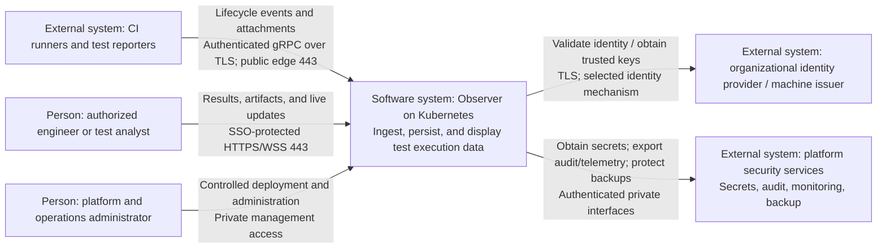
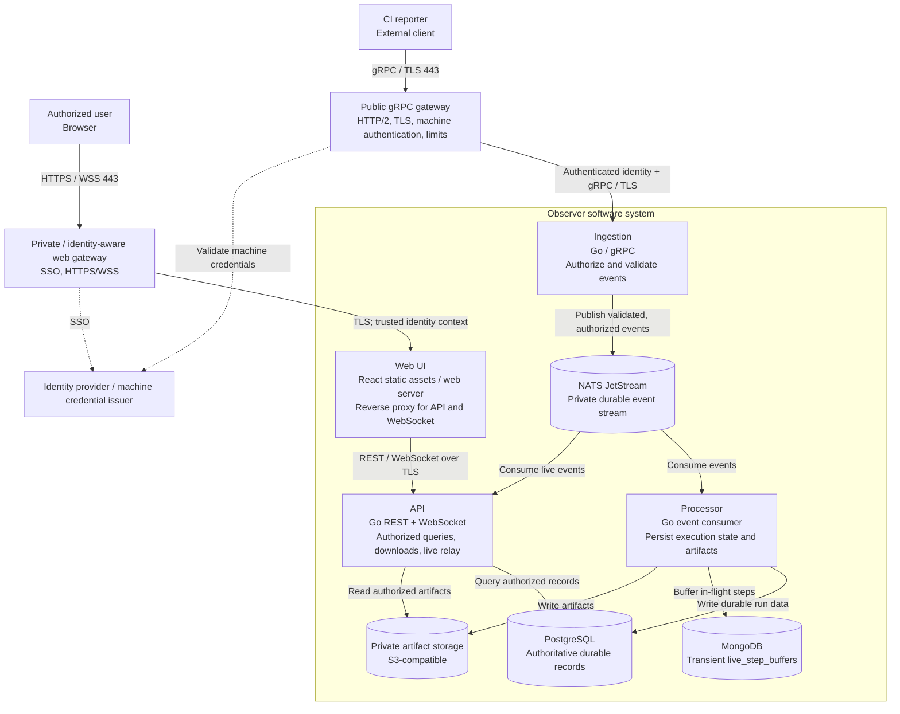

# 02 - C4 Architecture

**Status:** Proposed target state; security controls shown are requirements, not
implemented-capability claims. Managed dependencies may live outside the cluster.

## C4 Level 1 - System Context

Observer's system boundary includes its dedicated data services and storage,
whether operated in-cluster or supplied as managed dependencies. Shared identity
and platform systems are outside that ownership boundary.

## C4 Level 2 - Containers

Here, "container" means a C4 runtime/data-store boundary, not necessarily a
single Kubernetes container. Gateways are platform components outside Observer's
application boundary.

The edge validates machine identity; ingestion must still enforce authorization
for the target project/run. API authorization must apply equally to REST, artifact
retrieval, and WebSocket subscriptions. Browser-to-API logical requests pass
through the protected web route in this topology.

Database/broker/object-storage connections must be authenticated and encrypted
according to the network matrix. Dashed identity links represent conceptual
validation dependencies; offline JWT validation need not call the issuer per request.

## Interpretation and boundaries

- Reporters and event payloads are untrusted even after authentication.
- NATS contains potentially sensitive events; live WebSocket delivery crosses the
  same project authorization boundary as persisted reads.
- MongoDB is not a second durable query store. PostgreSQL remains canonical.
- Artifact bytes are untrusted content, not executable application assets.
- Secrets, migration jobs, backup paths, and infrastructure boundaries appear in
  [the deployment view](03-deployment-and-network.md).
- Level 3 component diagrams should be added when the selected authentication,
  authorization, or artifact-handling design needs internal implementation review.
