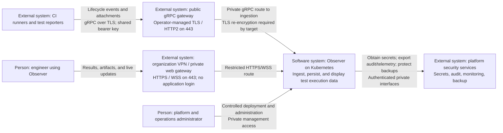
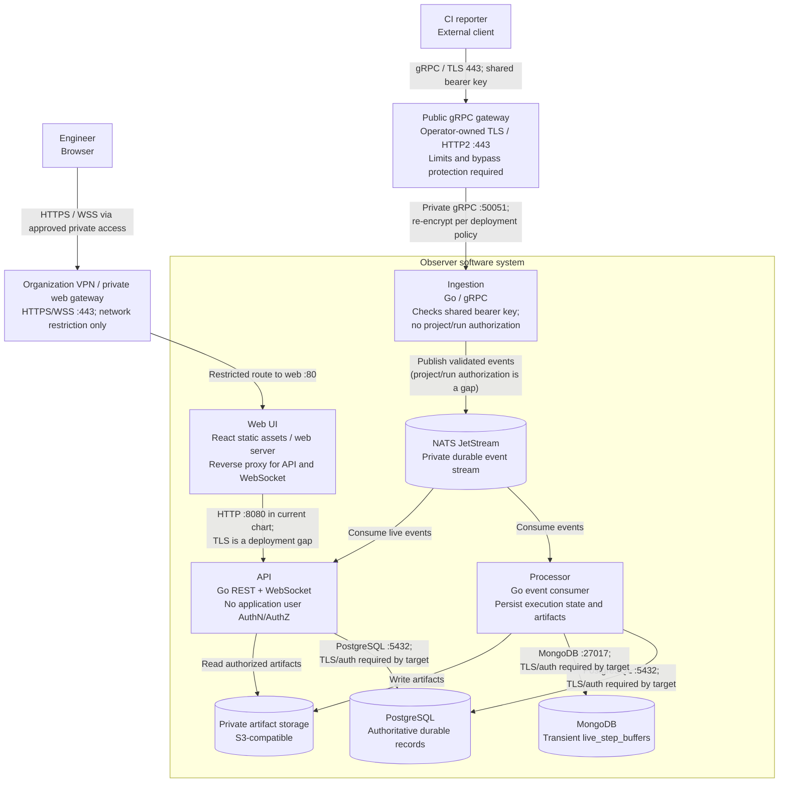

# 02 - C4 Architecture

**Status:** Intended distributed deployment target. Platform controls are
deployment requirements, not claims that Helm or Observer enforces them. The
current implementation and chart state are summarized in
[the security-review overview](../security-review/deployment-security-overview.md).
Managed dependencies may live outside the cluster.

## C4 Level 1 - System Context

Observer's system boundary includes its dedicated data services and storage,
whether operated in-cluster or supplied as managed dependencies. Shared platform
security services are outside that ownership boundary.

## C4 Level 2 - Containers

Here, "container" means a C4 runtime/data-store boundary, not necessarily a
single Kubernetes container. Gateways are platform components outside Observer's
application boundary.

The shared bearer key is checked by Observer; it is not project/run authorization.
The gateway must only route to the intended ingestion endpoint, and the cluster
must prevent direct gateway bypass. The VPN/private route is a network boundary,
not application user authentication or authorization. Browser-to-API requests
pass through the web route in this topology; API authorization is still required
for REST, mutations, attachments, and WebSocket subscriptions before that control
can be considered complete.

Database, broker, and object-storage connections must be authenticated and
encrypted according to the network matrix. The current chart defaults do not
provide all of these protections; see the current-state comparison below.

## Current implementation vs target

| Area | Current implementation / chart | Intended target |
| --- | --- | --- |
| Public gRPC | Distributed ingestion enforces one shared bearer key; Service is `ClusterIP`. Helm creates no public gateway, TLS route, or rate limit. | Operator-managed public TLS/HTTP2 gateway on 443, private-only backend path with bypass prevention, abuse limits, and project/run authorization. |
| Web/API access | No application user AuthN/AuthZ. The chart creates ClusterIP Services, not a VPN gateway or Ingress. | Web/API reachable only through the organization's VPN/private access route. Treat VPN restriction as a compensating network control, not user authorization. |
| Internal transport and isolation | Bundled NATS defaults to unauthenticated NATS; PostgreSQL defaults to `sslmode=disable`; MongoDB and Web-to-API use no TLS by default. No Observer/NATS default-deny policy is rendered; bundled database policies are permissive. | Authenticated and encrypted service-to-service connections, scoped credentials, and default-deny network policies with explicit flows. |
| Scope and diagrams | [Current-state security-review diagrams](../security-review/architecture/) document application/chart behavior and operator-selected routes. | This document and the [deployment/network target](03-deployment-and-network.md) describe required deployment controls; they are not deployment evidence. |

## Interpretation and boundaries

- Reporters and event payloads are untrusted even after authentication.
- NATS contains potentially sensitive events; live WebSocket delivery crosses the
  same project authorization boundary as persisted reads.
- MongoDB is not a second durable query store. PostgreSQL remains canonical.
- Artifact bytes are untrusted content, not executable application assets.
- Secrets, migration jobs, backup paths, and infrastructure boundaries appear in
  [the deployment view](03-deployment-and-network.md).
- Level 3 component diagrams should be added when the selected authentication,
  authorization, or artifact-handling design needs internal implementation review.
