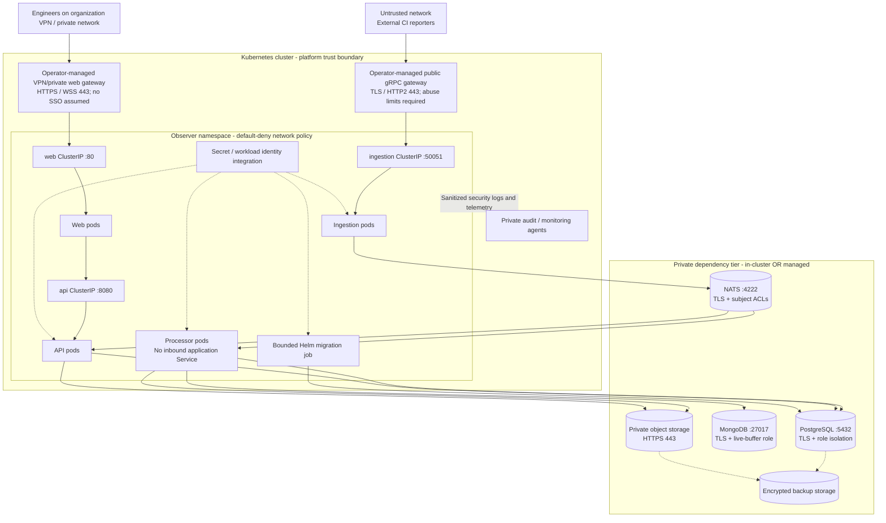

# 03 - Kubernetes Deployment and Network

**Status:** Intended distributed deployment target; actual endpoints and
enforcement evidence pending. This topology assumes Web/API access is restricted
to the organization's VPN or private network. That is a platform control, not
application AuthN/AuthZ.

## Deployment view

Service ports reflect the chart's stable distributed contract, not a declaration
that these ports natively terminate TLS. The chart creates no gateway, VPN route,
or TLS listener. The intended public gRPC route terminates TLS at the
operator-managed gateway; the gateway-to-Ingestion path must be private and use
TLS/re-encryption where required by policy. The web gateway must only be reachable
through approved VPN/private access, and direct Web/API service exposure must be
prevented. VPN access does not provide application user identity or authorization.
Certificates must validate the destination identity; encryption without certificate
verification does not satisfy this target. The dependency tier box is a logical
private boundary, not a fixed location.

## Network flow matrix

All unlisted traffic is denied by default. Dependency ports are defaults; the
assessed deployment must record its actual ports and endpoints.

| ID | Source -> destination | Protocol/port | Purpose and required protection | Enforcement owner |
| --- | --- | --- | --- | --- |
| NET-01 | CI reporter -> public gateway | gRPC over TLS/TCP 443, HTTP/2 | Shared bearer key is currently enforced by Ingestion; add quotas/abuse limits and project/run authorization | Platform + application |
| NET-02 | Public gateway -> ingestion | Private gRPC route to TCP 50051; TLS/re-encryption per policy | Gateway-only reachability; prevent direct Service bypass; validate certificates where TLS is used | Platform + application |
| NET-03 | VPN user -> web gateway | HTTPS/WSS TCP 443 | VPN/private access restriction; no application SSO is implemented or assumed | Platform |
| NET-04 | Web gateway -> web -> API | HTTPS/WSS at the edge; chart Services 80/8080 | No alternate public route; secure the web-to-API hop (currently HTTP); application authorization remains required | Platform + application |
| NET-05 | Ingestion -> NATS | TLS TCP 4222 | Publish-only credentials for required subjects | Platform + application |
| NET-06 | Processor/API -> NATS | TLS TCP 4222 | Separate identities; limited consumers, subjects, and stream operations | Platform + application |
| NET-07 | Processor/API -> PostgreSQL | PostgreSQL TLS TCP 5432 | Separate write/read roles; API gets only required mutation privileges | Platform + data |
| NET-08 | Processor -> MongoDB | MongoDB TLS TCP 27017 | Live-buffer database/collection scope only | Platform + data |
| NET-09 | Processor/API -> artifact storage | HTTPS TCP 443 | Write/read role separation; bucket/prefix restrictions | Platform + application |
| NET-10 | Migration job -> PostgreSQL | PostgreSQL TLS TCP 5432 | Temporary schema-change identity; not used by runtime pods | Platform + release |
| NET-11 | Workloads/gateways -> identity, DNS, secrets | HTTPS TCP 443; DNS UDP/TCP 53 | Only selected providers/resolvers; short-lived identity and key refresh | Platform + identity |
| NET-12 | Workloads -> telemetry collector | Approved encrypted collector protocol/port | Sanitized events; collector-only egress | Operations + platform |
| NET-13 | Approved admin/backup agents -> dependencies | Provider-specific private encrypted interfaces | Audited administration, backup and restore; no public admin listeners | Operations + platform |

## Exposure requirements

- **NET-14:** Keep Observer Services `ClusterIP`; publish only the selected gateways.
  Prohibit accidental public NodePort/LoadBalancer paths, including direct API access.
- **NET-15:** Enforce ingress and egress policies with a supporting CNI. Namespace
  labels alone are not authorization. Cover gateway namespaces and managed endpoints.
- **NET-16:** Support HTTP/2 gRPC correctly, bounded request/connection timeouts,
  certificate rotation, and WebSocket upgrades without bypassing access checks.
- **NET-17:** Disable public dependency monitoring/admin ports. Health endpoints
  must not disclose secrets or provide an unprotected application route.
- **NET-18:** Restrict cluster administration, image pulls, and backup traffic via
  separately documented platform paths; validate these exceptions before applying deny-all.
- **NET-19:** If artifact downloads redirect to signed URLs, add the browser-to-storage
  path to this matrix and enforce the controls in document 05.

Record TLS minimum versions/ciphers per organizational policy, certificate issuer,
expiry alerts, backend trust roots, and enforcement manifests in the evidence appendix.

The current Helm chart uses HTTP from Web to API, bundled NATS without
authentication by default, and PostgreSQL with `sslmode=disable` by default.
These are implementation gaps against the target above, not controls provided by
the VPN. See the [current-state vs target comparison](02-c4-architecture.md#current-implementation-vs-target)
and [current implementation overview](../security-review/deployment-security-overview.md).
