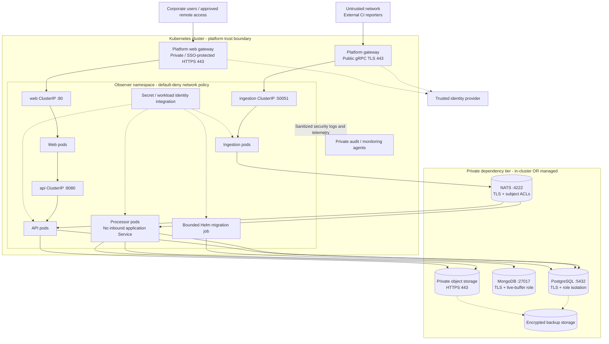

# 03 - Kubernetes Deployment and Network

**Status:** Proposed topology; actual endpoints and enforcement evidence pending.

## Deployment view

Service ports reflect the chart's stable distributed contract, not a declaration
that these ports natively terminate TLS. TLS listeners/proxies and re-encryption
must be implemented and documented. Certificates must validate the destination
identity; encryption without certificate verification does not satisfy this target.
The dependency tier box is a logical private boundary, not a fixed location.

## Network flow matrix

All unlisted traffic is denied by default. Dependency ports are defaults; the
assessed deployment must record its actual ports and endpoints.

| ID | Source -> destination | Protocol/port | Purpose and required protection | Enforcement owner |
| --- | --- | --- | --- | --- |
| NET-01 | CI reporter -> public gateway | gRPC over TLS/TCP 443, HTTP/2 | Authenticated machine submission; quotas and optional source allowlist | Platform + application |
| NET-02 | Public gateway -> ingestion | gRPC/TLS TCP 50051 or approved TLS listener | Re-encryption; gateway-only reachability; trustworthy caller identity | Platform + application |
| NET-03 | User -> web gateway | HTTPS/WSS TCP 443 | SSO; approved corporate/private access policy | Platform + identity |
| NET-04 | Web gateway -> web -> API | HTTPS/WSS; Services 80/8080 or approved TLS listeners | No unprotected alternate route; verified upstream TLS; authorization at API | Platform + application |
| NET-05 | Ingestion -> NATS | TLS TCP 4222 | Publish-only credentials for required subjects | Platform + application |
| NET-06 | Processor/API -> NATS | TLS TCP 4222 | Separate identities; limited consumers, subjects, and stream operations | Platform + application |
| NET-07 | Processor/API -> PostgreSQL | PostgreSQL TLS TCP 5432 | Separate write/read roles; API gets only required mutation privileges | Platform + data |
| NET-08 | Processor -> MongoDB | MongoDB TLS TCP 27017 | Live-buffer database/collection scope only | Platform + data |
| NET-09 | Processor/API -> artifact storage | HTTPS TCP 443 | Write/read role separation; bucket/prefix restrictions | Platform + application |
| NET-10 | Migration job -> PostgreSQL | PostgreSQL TLS TCP 5432 | Temporary schema-change identity; not used by runtime pods | Platform + release |
| NET-11 | Workloads/gateways -> identity, DNS, secrets | HTTPS TCP 443; DNS UDP/TCP 53 | Only selected providers/resolvers; short-lived identity and key refresh | Platform + identity |
| NET-12 | Workloads -> telemetry collector | Approved encrypted collector protocol/port | Sanitized events; collector-only egress | Operations + platform |
| NET-13 | Approved admin/backup agents -> dependencies | Provider-specific private encrypted interfaces | Audited administration, backup and restore; no public admin listeners | Operations + platform |

## Exposure requirements

- **NET-14:** Keep Observer Services `ClusterIP`; publish only the selected gateways.
  Prohibit accidental public NodePort/LoadBalancer paths, including direct API access.
- **NET-15:** Enforce ingress and egress policies with a supporting CNI. Namespace
  labels alone are not authorization. Cover gateway namespaces and managed endpoints.
- **NET-16:** Support HTTP/2 gRPC correctly, bounded request/connection timeouts,
  certificate rotation, and WebSocket upgrades without bypassing access checks.
- **NET-17:** Disable public dependency monitoring/admin ports. Health endpoints
  must not disclose secrets or provide an unprotected application route.
- **NET-18:** Restrict cluster administration, image pulls, and backup traffic via
  separately documented platform paths; validate these exceptions before applying deny-all.
- **NET-19:** If artifact downloads redirect to signed URLs, add the browser-to-storage
  path to this matrix and enforce the controls in document 05.

Record TLS minimum versions/ciphers per organizational policy, certificate issuer,
expiry alerts, backend trust roots, and enforcement manifests in the evidence appendix.
