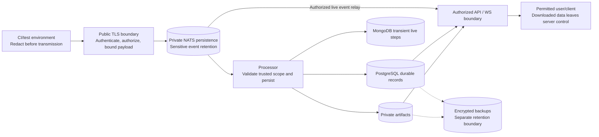

# 05 - Data Inventory and Handling

**Status:** Target policy; classification and retention decisions pending data-owner approval.

## Inventory

Classification labels below are provisional; map them to organizational policy.
Test payloads may contain more sensitive data than their metadata suggests.

| Data category | Examples | Locations / recipients | Proposed handling |
| --- | --- | --- | --- |
| Execution metadata | Project, repository paths, branch/commit metadata, test names, actor identifiers | NATS, PostgreSQL, authorized API/WS clients | Internal; potentially confidential or personal |
| Test output and failures | Stack traces, request bodies, console logs, step details | NATS, PostgreSQL; MongoDB during buffering; WS | Confidential by default; redact secrets and personal data |
| Attachments | Screenshots, traces, recordings, reports | Transport/stream where carried; private object storage; PostgreSQL metadata; downloads | Confidential untrusted content; may expose credentials or personal data |
| Live-step buffers | In-flight step content and identifiers | MongoDB `live_step_buffers` | Same sensitivity as source data despite transient use |
| Authentication material | Tokens, client keys, DB/storage credentials | CI secret store, secret provider, workload memory | Restricted; never include in test payloads or ordinary logs |
| Security/operational records | Access decisions, actor IDs, source addresses, request IDs | Approved audit/telemetry store | Restricted access; privacy and retention review |
| Backups and replicas | Durable records, artifacts; selected stream backups | Encrypted private backup/replica destinations | Inherit source classification and residency restrictions |

## Security data-flow view

Credential and audit flows are separate from test payloads. Storage location,
residency, encryption keys, and applicable backup copies must be recorded for
every selected dependency, including managed services.

## Handling requirements

- **DATA-01:** Minimize collected fields; prohibit secrets and production personal
  data unless explicitly approved. Redact at the reporter/source before publication.
  Define server-side rejection/quarantine rules as additional defense, not a guarantee
  that arbitrary sensitive content can be detected.
- **DATA-02:** Encrypt transport and storage, including PVCs, NATS persistence,
  databases, artifacts, logs, replicas, and backups. Record key ownership, access,
  rotation, recovery, and residency requirements.
- **DATA-03:** Store artifacts privately with generated storage keys. Prevent path
  traversal, arbitrary URL fetching/SSRF, cross-project key access, and public ACLs.
  If remote artifact fetching is supported, restrict destinations and redirects.
- **DATA-04:** Treat files as hostile. Define permitted content types, size limits,
  malware scanning/quarantine policy, and handling of archives/decompression.
  Do not execute uploaded content. Do not render active content in the application's
  trusted origin; use safe download headers or an isolated, credential-free origin.
- **DATA-05:** Authorize artifact retrieval against its owning project/run, not
  possession of a filename/key. Signed URLs, if selected, must be short-lived,
  object-specific, generated only after authorization, and excluded from logs.
  Record their expiry and revocation limitations.
- **DATA-06:** Apply the same sensitivity and project restrictions to WebSocket
  payloads as REST data. Review raw events for fields not intended for users.
- **DATA-07:** Establish coordinated deletion across run records, attachment objects,
  live buffers, broker retention, caches, audit records where legally permitted,
  and backup expiry. Document deletion lag and legal-hold exceptions.
- **DATA-08:** On restore, reapply deletion/tombstone records so expired or deleted
  data is not silently reintroduced. Retain tombstones for the applicable backup horizon.
- **DATA-09:** Mask credentials and payloads in logs/errors. Use synthetic or sanitized
  fixtures for support, testing, scans, and review evidence.

## Retention schedule to complete before approval

No durations are asserted here. "Transient" does not establish a deletion guarantee.

| Store | Required policy decision | Verification evidence |
| --- | --- | --- |
| PostgreSQL | Run/attempt/attachment metadata lifetime; legal holds | Deletion jobs and scoped deletion tests |
| NATS JetStream | Maximum event age/bytes, replica/snapshot retention | Stream configuration and expiry/limit tests |
| MongoDB live buffers | Completion cleanup and maximum orphan lifetime | Cleanup/TTL configuration and abandoned-run tests |
| Artifact storage | Object lifetime, versions, incomplete uploads, holds | Lifecycle policy and object/version deletion tests |
| Audit/telemetry | Investigation needs versus privacy/minimization | Approved retention and access policy |
| Backups | Expiry, immutability, residency, deletion reapplication | Backup policy and restore drill |

The data owner must approve actual durations, deletion SLOs, residency, and
exceptions under D-05/D-08.
