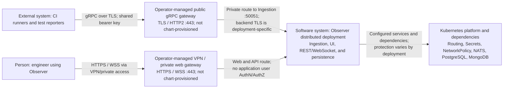

# Observer — Current Implementation and Helm State

**Scope:** current application behavior and default distributed Helm resources.
This is the current-state view, not the intended security target or evidence of
cluster enforcement. The VPN/private Web route and public gRPC gateway described
below are operator-provided deployment assumptions; neither is installed by Helm.
See the [current-vs-target comparison](../infosec/02-c4-architecture.md#current-implementation-vs-target)
and [deployment/network target](../infosec/03-deployment-and-network.md) for
required controls.

The accompanying [container diagram](architecture/container-architecture.drawio)
and [Kubernetes deployment diagram](architecture/kubernetes-deployment.drawio)
are current-state views. The deployment diagram shows the intended operator
entry paths as external, non-chart resources; it does not assert that any
particular cluster has configured them.

## Current-state C4 Level 1 — System Context

The routes below show the intended operator-managed exposure for a distributed
Kubernetes deployment. The gateways are not provisioned by Helm; actual exposure
and backend encryption must be verified for each assessment environment.

## 1. System overview

Observer collects test events and displays runs, failures, and attachments.
The documented Playwright reporter or another compatible gRPC client sends
events to ingestion and NATS JetStream. The processor persists results in
PostgreSQL and buffers active steps in MongoDB. React pages poll REST; `/ws`
also relays live events to other clients.
([Reporter integration](../architecture/08-reporter-integration.md),
[processor](../../cmd/processor/main.go),
[UI polling](../../web/src/pages/TestRunsPage/TestRunsPage.tsx),
[API](../../cmd/api/main.go))

## 2. Deployment footprint

By default, Helm installs four single-replica Deployments (ingestion,
processor, API, web), three ClusterIP Services, and a migration Job. It also
deploys NATS and PostgreSQL StatefulSets and a MongoDB Deployment, each with
a **10 GiB** persistent claim. External equivalents can replace them;
S3-compatible storage is optional and not provisioned.
([Chart dependencies](../../charts/observer/Chart.yaml),
[defaults](../../charts/observer/values.yaml),
[migration Job](../../charts/observer/templates/distributed/migration/migration-job.yaml))

## 3. Network interfaces

| Source | Destination | Protocol/port | Purpose | Exposure |
| --- | --- | --- | --- | --- |
| CI/test runner | Operator-managed public gRPC gateway → Ingestion Service | gRPC/TLS `443` externally; gRPC `50051` to Service | Submit events with the shared bearer key | Helm creates no gateway; private backend reachability and TLS re-encryption are operator/deployment decisions. |
| Engineer on organization VPN/private network | Operator-managed private gateway → Web Service | HTTPS `443` externally; HTTP `80` to Service | UI and same-origin REST | Intended restricted route; neither VPN access nor gateway is chart-enforced. |
| Optional WebSocket client | Web proxy → API | HTTP upgrade `/ws` | Live events | Same entry; the UI itself polls REST. |
| Web | API Service | HTTP/TCP `8080` | Proxy `/api/*` and `/ws` | ClusterIP; direct API exposure is configurable. |
| Ingestion | NATS | NATS/TCP `4222` | Publish `tests.events.v1.<type>` subjects | Bundled Service is cluster-internal. |
| Processor; API | NATS | NATS/TCP `4222` | Pull events; relay live events | Bundled Service is cluster-internal. |
| Processor | MongoDB | MongoDB/TCP `27017` | Live step buffers | Bundled Service is cluster-internal. |
| Processor; API; migration Job | PostgreSQL | PostgreSQL/TCP `5432` | Persist, query, mutate, migrate | Bundled Service is cluster-internal. |
| Processor; API; browser | Optional S3-compatible store | HTTP(S), configured endpoint | Upload/retrieve; follow redirects | Location and endpoint are configurable. |

Ingestion also listens on HTTP `8081` for health, but its distributed
Service exposes only `50051`; probes use gRPC health. Bundled NATS monitoring
`8222` is on its headless Service. `ClusterIP` alone does not establish
isolation; exposing the API directly can bypass the web proxy. External
dependency ports and TLS are configurable.
([Ingestion](../../cmd/ingestion/main.go),
[web proxy](../../docker/nginx/nginx.web.conf.template),
[Services](../../charts/observer/templates/distributed/),
[publisher](../../pkg/publisher/nats.go))

## 4. Authentication, authorization and secrets

Distributed ingestion requires a Secret referenced by
`distributed.ingestion.auth.existingSecret`; clients send its
`INGESTION_AUTH_KEY` as gRPC `authorization: Bearer …` metadata. The key must
be at least 32 printable, non-whitespace bytes. This shared key proves
possession, not reporter identity or project/run authorization. Health is
exempt; reflection is disabled. The Playwright and pytest reporters support
the configured key variable; compatibility was exercised in the test
deployment.
([Server authentication](../../pkg/server/server.go#L341),
[Helm validation](../../charts/observer/templates/_helpers.tpl#L181))

The UI, REST API (including deletion and marker updates), attachment endpoints,
and WebSocket have **no application user authentication or authorization**.
CORS defaults to `*`; its non-wildcard branch reflects any origin, and
WebSocket accepts all origins. These are not access controls. Web, API, and
gRPC listeners do not terminate TLS; access restrictions and TLS depend on
the selected platform.
([API routes and CORS](../../cmd/api/main.go),
[mutations](../../pkg/api/rest_postgres.go#L32),
[WebSocket origin check](../../pkg/websocket/websocket.go#L79))

Bundled PostgreSQL and MongoDB use generated credentials from Secrets;
PostgreSQL uses `sslmode=disable`, while bundled NATS defaults to unauthenticated
`nats://`. The API Pod receives MongoDB credential settings, although the API
does not connect to MongoDB. `runtime.existingSecret` can supply external
connection settings, but Helm still requires the external host/URL values.
S3 credentials and a CA can also be Secret-backed. Without a runtime Secret,
an external PostgreSQL migration DSN is rendered as a literal environment
value. Services log NATS URLs, including any embedded credentials.
([Connection configuration](../../charts/observer/values.yaml#L290),
[API deployment](../../charts/observer/templates/distributed/api/api-deployment.yaml),
[migration template](../../charts/observer/templates/distributed/migration/migration-job.yaml),
[NATS logging](../../pkg/publisher/nats.go#L85))

## 5. Data handling

Names, timing, metadata, source locations, steps, failures, stack traces,
stdout/stderr, and attachments such as screenshots or logs may contain
sensitive application data, credentials, or personal data. JetStream carries
events; PostgreSQL stores structured results and inline attachments.
Dedicated stdout/stderr event handlers do not persist those events, although
output may be included in attachments. Service logs can include test names
and failure messages.
([Event handlers](../../pkg/server/server.go),
[stdout/stderr handling](../../pkg/consumer/nats_std_handlers.go),
[relational model](../../internal/models/relational.go))

Attachments below 100 KiB are inline base64; larger content uses a configured
local/S3 driver or falls back to inline. With no default driver, all content
is inline. A local driver needs shared processor/API storage, not provided
by the distributed chart. URI references are supported. The API can proxy
objects or redirect to a 15-minute presigned S3 URL; a configured
`STORAGE_S3_PUBLIC_URL` instead produces an unsigned URL with the object key.
([Attachment processing](../../pkg/consumer/nats_test_handlers.go#L293),
[retrieval](../../pkg/api/attachments_postgres.go),
[S3 URL handling](../../pkg/storage/s3.go#L249))

A **new** JetStream stream has a 24-hour maximum age; existing streams are
unchanged. MongoDB buffers are normally deleted after flushing and have a
configurable expiry timestamp, default 15 minutes after an update. No
automatic PostgreSQL or external-object retention was found. Manual run
deletion removes PostgreSQL records, not external objects.
([Stream configuration](../../pkg/publisher/nats.go#L91),
[buffer TTL](../../internal/database/mongodb.go#L22),
[run deletion](../../internal/repository/postgres/postgres_query_mutations.go))

## 6. Kubernetes-specific considerations

- The four application containers request **450m CPU and 576 MiB** combined,
  excluding dependencies and migration. The rendered NATS server/reloader
  have no requests or limits despite `nats.resources` values. The bundled
  MongoDB image is `linux/amd64` only.
- The four Deployments use a chart ServiceAccount; migration and bundled NATS
  use the namespace default account. No Role/RoleBinding is rendered by
  default; token automount is not explicitly disabled for Observer workloads.
- Ingestion, processor, API, and migration default to UID 1000, drop
  capabilities, and disallow privilege escalation. Web defaults to UID 0;
  the ingestion wait-for-NATS init container has no explicit container
  security context.
- Bundled MongoDB/PostgreSQL NetworkPolicies allow ingress from any source to
  database ports and all egress. No Observer/NATS isolation policy, Ingress,
  Gateway, or Certificate is rendered by default.

See the [values](../../charts/observer/values.yaml), [workload templates](../../charts/observer/templates/distributed/),
and [chart contract](../../charts/observer/README.md). Effective policies
also depend on the cluster's networking implementation and other configuration.

## 7. Known limitations and deployment considerations

- **Implementation characteristic:** the shared key is not per-reporter or
  project authorization; Observer does not restrict UI/API users.
- **Deployment decision:** select exposure paths, TLS, dependency
  authentication, and network isolation.
- **Hosting infrastructure:** DNS, image pulls, volumes, secrets, monitoring,
  and ingress access controls depend on cluster/organizational services.
- **Unresolved:** reporter compatibility, permitted test data, retention,
  backups, external-object cleanup, cluster policies, and capacity.
